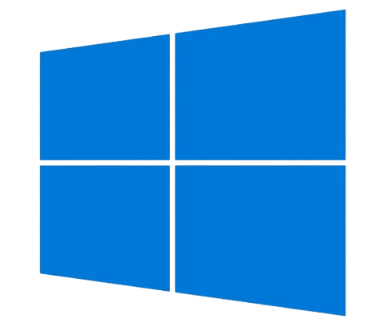

    
此图所有权归微软。

    <h1>Windows 10 2026</h1>
    <h3>T-PageCode</h3>
    
Languages: HTML CSS JavaScript

    <h2>免责声明</h2>
    
此项目跟微软没有任何关系，图标等资源所有权均归微软，请仔细辨别。

    <h2>项目地址</h2>
    <a href="https://github.com/T-PageCode/Windows10-2026">GitHub地址</a>&nbsp;&nbsp;&nbsp;<a href="https://t-pagecode.github.io/Windows10-2026">在线体验地址</a>

